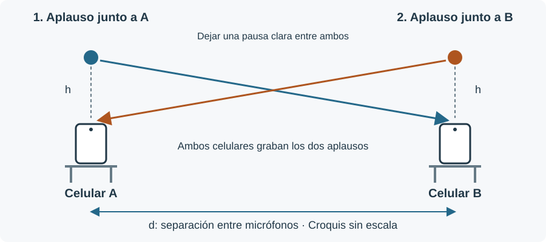

# Bitácora de laboratorio

## 26 de agosto · Primeras pruebas: versión inicial

Empiezo con un aplauso frente a una pared. La idea es medir cuánto tarda en volver el eco y usar `v = 2d/Δt`, porque el sonido va hasta la pared y vuelve.

Pruebo a 3; 4,5 y 6 metros. Otra persona sostiene el celular y yo aplaudo. Tanto el teléfono como las manos quedan en posiciones aproximadas. Hago cinco grabaciones, con repeticiones a 4,5 y 6 metros.

**29 de agosto · Validación de mediciones:**
Los resultados no son confiables: a 3 metros el programa no encuentra el eco y en las otras tomas marca sonidos que no está claro que sean la reflexión.

Después pruebo una nota de piano reproducida por un celular y grabada por el otro, a distancias de hasta 9 metros. El sonido dura bastante y puede mezclarse con su eco. Que el volumen suba un poco no alcanza para saber cuándo llega: también puede cambiar el sonido original o la grabación.

**29 de agosto · Bug del programa:** Se usaba como referencia una velocidad de sonido conocida para saber en que rango buscar el eco, eso provocaba que hubiera un sobre ajuste y sin importar el sonido, daba una velocidad de sonido cercana a 340 m/s.

**2 de septiembre · Bug del programa:** Se cambia esa búsqueda para que el tiempo se detecte sin usar la distancia ni una velocidad esperada. Con ese criterio, pero ahora estas grabaciones no permiten obtener una medición confiable.

**2 de septiembre · Bug del programa:** Analizando los audios de las pruebas, detecté que es dificil/imposible detectar la onda del eco ya que es débil y sobre todo las distancias usadas son muy pequeñas, lo que generaba que el eco llegara cuando aun yo estoy provocando el sonido, por ende diferenciar la onda original de la del eco a esas distancias no era un método confiable.

## 5 de septiembre de 2026 · Versión 2, pasar a dos celulares y dos aplausos

Como tengo poco espacio, hasta unos 9 metros, paso a trabajar con dos sonidos directos. Así no tengo que separar un eco débil del sonido original.

El procedimiento es este:

1. Poner los celulares A y B separados y medir la distancia entre sus micrófonos.
2. Dejar ambos grabando. No hace falta iniciarlos al mismo tiempo.
3. Dar un aplauso cerca de A.
4. Después de una pausa clara, dar otro cerca de B. Puede ser alrededor de uno o dos segundos; no tiene que ser un tiempo exacto.
5. Detener las grabaciones después del segundo aplauso. **Cada archivo tiene que contener los dos.**

**Montaje para repetir la prueba:** dos celulares sobre sillas, una cinta con divisiones de 1 mm y dos personas para aplaudir. Mido entre micrófonos, mantengo los teléfonos quietos y dejo unos segundos de audio antes y después.

Croquis sin escala, reconstruido a partir de la descripción del montaje. La altura h corresponde a la separación vertical entre manos y micrófono. La igualdad de alturas es un supuesto del cálculo geométrico; no una medición exacta de cada toma.

Con dos aplausos mido un intervalo dentro de cada audio:

- **TA:** desde el primer aplauso hasta el segundo, en el audio A.
- **TB:** lo mismo, en el audio B.

`TA = tA2 − tA1` y `TB = tB2 − tB1`.

Si llamo **R** a lo que espera la persona de B desde que oye el primer aplauso hasta que da el segundo, aproximadamente:

`TA = d/v + R + d/v` y `TB = R`.

Al restar, la espera desaparece:

**`TA − TB = 2d/v` → `v = 2d/(TA − TB)`**.

Esto supone que cada aplauso ocurre muy cerca de su micrófono.

## 12 de septiembre de 2026 · Primera prueba de las segunda versión

Probé hacer "gritos" tipo «AAA», por facilidad y asi poder generar sonidos de mayor volumen, pero el código cuesta detectar el momento exacto de inicio de cada "grito", y una pequeña diferencia provoca un cambio elevado en el calculo de la velocidad, por ende concluyo que lo mejor es seguir con los aplausos.

Esta serie de gritos no da una velocidad confiable. Tampoco alcanza con comparar las formas de las ondas por correlación: el resultado cambia según qué parte del grito se toma.

## 19 de septiembre de 2026 · Método de aplausos

Primero para comprobar si un aplauso funcionaría, hago una prueba simple poniendo los dos teléfonos juntos y aplaudiendo dos veces y con código detecto el instante donde se detecta el aplauso en cada audio y los resto, esto me dió una diferencia de un teléfono al otro de **1,021 ms**. Por ende lo considero como un método válido.

## 19 de septiembre de 2026 · Nuevas mediciones con aplausos

Esta vez uso aplausos cortos. Las separaciones son **3; 4; 5; 6; 7 y 7,8 metros**.

Al principio, algunos ruidos graves se cuentan como sonidos adicionales y el programa rechaza pares. Se agrega un filtro pasaaltos de **1000 Hz** para ayudar a encontrar los aplausos cuando hay esos ruidos. Reduce los graves; después los inicios se buscan en el audio original. Si siguen apareciendo más de dos eventos sin poder distinguirlos, el caso queda como ambiguo.

Con ese cambio se pueden calcular todos los pares de mediciones sin ingresar marcas a mano (el programa permite también agregar manualmente donde estaría la onda del aplauso). Los tiempos se buscan usando el audio; la distancia se usa después para calcular la velocidad.

### Resultados

| d (m) |   TA (s) |   TB (s) | TA−TB (ms) | v individual (m/s) |
| ----: | -------: | -------: | ---------: | -----------------: |
|   3,0 | 1,800458 | 1,786021 |     14,438 |              415,6 |
|   4,0 | 1,287042 | 1,266187 |     20,854 |              383,6 |
|   5,0 | 1,769667 | 1,743437 |     26,229 |              381,3 |
|   6,0 | 2,292000 | 2,260375 |     31,625 |              379,4 |
|   7,0 | 1,782396 | 1,743813 |     38,583 |              362,9 |
|   7,8 | 3,091417 | 3,048063 |     43,354 |              359,8 |

## 19 de septiembre de 2026 · Conclusión

El cálculo podría mejorarse si se aumenta la distancia entre los teléfonos ya que errores como ubicación del aplauso o detector serían proporcionalmente menores.

## 12 de octubre de 2026 · Registro de nuevas pruebas a 16 °C

Registro una nueva serie de mediciones con los dos celulares y dos aplausos, esta vez a **16 °C**. La primera versión se había realizado a **20 °C**.

Para explorar el efecto de la posición del aplauso, hago dos modalidades en cada distancia:

- **Normal:** el aplauso a la separación usual del teléfono, aproximadamente **30–40 cm**, principalmente hacia arriba respecto del micrófono.
- **Cerca:** el aplauso más próximo al teléfono. No quedó registrada una separación exacta para esta modalidad.

Las nuevas separaciones entre teléfonos son **3, 4, 5, 6, 7 y 8 m**: seis pares de audios para normal y seis para cerca. El número del archivo indica esa distancia. Los archivos se organizan actualmente en `audios/2_40cm` y `audios/3_proximo`, cada una con subcarpetas `A` y `B`. Posteriormente se retiró el par de 3 m de la segunda tanda a unos 40 cm de las sesiones activas; el registro y los resultados de esta entrada corresponden a la serie original de seis pares.

Con los audios actualmente incluidos y el procesamiento documentado en las sesiones, el ajuste normal da **303,4 ± 22,6 m/s** y el ajuste cerca **344,4 ± 32,1 m/s**. La referencia a 16 °C es **341,0 m/s**. Algunas tomas incluyen tratamientos de ruido registrados en el JSON; estos resultados corresponden a esas versiones de los audios.

El modelo geométrico para un aplauso desplazado principalmente hacia arriba sugiere un efecto pequeño sobre la pendiente cuando la altura se mantiene similar entre distancias, porque gran parte del cambio se absorbe en el intercepto. Esta comparación no alcanza para atribuir toda la diferencia entre normal y cerca a la posición del aplauso. Las sesiones nuevas mantienen excluido el antiguo aporte de altura; los otros aportes de incertidumbre siguen activos.

Entre 16 y 20 °C la predicción cambia **2,424 m/s**, menos que los márgenes actuales. Queda registrada la comparación con la teoría, aunque estas series no permiten aislar con precisión el efecto de esos 4 °C.

## 19 de octubre de 2026 · Modificaciones en la interfaz

Se agregan a la interfaz el resaltado de la toma seleccionada sobre el ajuste ΔT frente a distancia y la curva de velocidad teórica frente a temperatura. El análisis de posición, sus supuestos y la comparación térmica quedan desarrollados al final del [README](../README.md#13-pruebas-de-posición-del-aplauso-y-temperatura--registro-del-19-de-octubre-de-2026).
