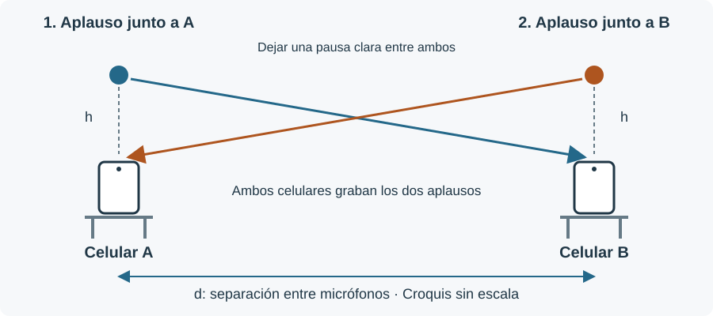

# Bitácora de laboratorio

## 26 de agosto · Primeras pruebas: versión inicial

Empiezo con un aplauso frente a una pared. La idea es medir cuánto tarda en volver el eco y usar `v = 2d/Δt`, porque el sonido va hasta la pared y vuelve.

Pruebo a 3; 4,5 y 6 metros. Otra persona sostiene el celular y yo aplaudo. Tanto el teléfono como las manos quedan en posiciones aproximadas. Hago cinco grabaciones, con repeticiones a 4,5 y 6 metros.

**29 de agosto · Validación de mediciones:**
Los resultados no son confiables: a 3 metros el programa no encuentra el eco y en las otras tomas marca sonidos que no está claro que sean la reflexión.

Después pruebo una nota de piano reproducida por un celular y grabada por el otro, a distancias de hasta 9 metros. El sonido dura bastante y puede mezclarse con su eco. Que el volumen suba un poco no alcanza para saber cuándo llega: también puede cambiar el sonido original o la grabación.

**29 de agosto · Bug del programa:** Se usaba como referencia una velocidad de sonido conocida para saber en que rango buscar el eco, eso provocaba que hubiera un sobre ajuste y sin importar el sonido, daba una velocidad de sonido cercana a 340 m/s.

**2 de septiembre · Bug del programa:** Se cambia esa búsqueda para que el tiempo se detecte sin usar la distancia ni una velocidad esperada. Con ese criterio, pero ahora estas grabaciones no permiten obtener una medición confiable.

**2 de septiembre · Bug del programa:** Analizando los audios de las pruebas, detecté que es dificil/imposible detectar la onda del eco ya que es débil y sobre todo las distancias usadas son muy pequeñas, lo que generaba que el eco llegara cuando aun yo estoy provocando el sonido, por ende diferenciar la onda original de la del eco a esas distancias no era un método confiable.

## 5 de septiembre de 2026 · Versión 2, pasar a dos celulares y dos aplausos

Como tengo poco espacio, hasta unos 9 metros, paso a trabajar con dos sonidos directos. Así no tengo que separar un eco débil del sonido original.

El procedimiento es este:

1. Poner los celulares A y B separados y medir la distancia entre sus micrófonos con una cinta métrica («centímetro»).
2. Dejar ambos grabando. No hace falta iniciarlos al mismo tiempo.
3. Dar un aplauso cerca de A.
4. Después de una pausa clara, dar otro cerca de B. Puede ser alrededor de uno o dos segundos; no tiene que ser un tiempo exacto.
5. Detener las grabaciones después del segundo aplauso. **Cada archivo tiene que contener los dos.**

**Montaje para repetir la prueba:** dos celulares sobre sillas, una cinta con divisiones de 1 mm y dos personas para aplaudir. Mido entre micrófonos, mantengo los teléfonos quietos y dejo unos segundos de audio antes y después.

Croquis sin escala, reconstruido a partir de la descripción del montaje. La altura h corresponde a la separación vertical entre manos y micrófono. La igualdad de alturas es un supuesto del cálculo geométrico; no una medición exacta de cada toma.

Con dos aplausos mido un intervalo dentro de cada audio:

- **TA:** desde el primer aplauso hasta el segundo, en el audio A.
- **TB:** lo mismo, en el audio B.

`TA = tA2 − tA1` y `TB = tB2 − tB1`.

Si llamo **R** a lo que espera la persona de B desde que oye el primer aplauso hasta que da el segundo, aproximadamente:

`TA = d/v + R + d/v` y `TB = R`.

Al restar, la espera desaparece:

**`TA − TB = 2d/v` → `v = 2d/(TA − TB)`**.

Esto supone que cada aplauso ocurre muy cerca de su micrófono.

## 12 de septiembre de 2026 · Primera prueba de las segunda versión

Probé hacer "gritos" tipo «AAA», por facilidad y asi poder generar sonidos de mayor volumen, pero el código cuesta detectar el momento exacto de inicio de cada "grito", y una pequeña diferencia provoca un cambio elevado en el calculo de la velocidad, por ende concluyo que lo mejor es seguir con los aplausos.

Esta serie de gritos no da una velocidad confiable. Tampoco alcanza con comparar las formas de las ondas por correlación: el resultado cambia según qué parte del grito se toma.

## 17 de septiembre de 2026 · Método de aplausos

Primero, para comprobar si los aplausos se podían reconocer en ambos registros, pongo los dos teléfonos juntos y grabo los mismos dos aplausos con ambos. En cada audio mido el tiempo transcurrido entre el primer y el segundo aplauso: `TA = tA2 − tA1` y `TB = tB2 − tB1`. Comparo esos intervalos y repito el ensayo **10 veces**, con dos aplausos por ensayo registrados por ambos teléfonos. La **media de las diferencias entre intervalos fue de 1,021 ms**.

Comparar los **intervalos entre los mismos dos aplausos** cancela el inicio distinto de cada grabación. Con micrófonos casi juntos y recorridos semejantes se espera `TA − TB ≈ 0`. La diferencia media informada de 1,021 ms representa aproximadamente entre el **2,3 % y el 6,8 %** de un D de 45 a 15 ms, el orden de magnitud de la primera tanda. Los diez ensayos constituyen un control inicial de concordancia entre los intervalos registrados. La media por sí sola no permite cuantificar su variabilidad ni calibrar los relojes o el detector: para eso se necesitan los valores individuales y su dispersión. No se aplica como corrección a las mediciones.

No dejé anotado si promedié diferencias con signo o sus magnitudes; para ampliar el análisis necesito incluir los valores individuales y su dispersión.

## 17 de septiembre de 2026 · Nuevas mediciones con aplausos

Esta vez uso aplausos cortos. Las separaciones son **3; 4; 5; 6; 7 y 7,8 metros**.

Al principio, algunos ruidos graves se cuentan como sonidos adicionales y el programa rechaza pares. Se agrega un filtro pasaaltos de **1000 Hz** para ayudar a encontrar los aplausos cuando hay esos ruidos. Reduce los graves; después los inicios se buscan en el audio original. Si siguen apareciendo más de dos eventos sin poder distinguirlos, el caso queda como ambiguo.

Con ese cambio se pueden calcular todos los pares de mediciones sin ingresar marcas a mano (el programa permite también agregar manualmente donde estaría la onda del aplauso). Los tiempos se buscan usando el audio; la distancia se usa después para calcular la velocidad.

### Resultados

| d (m) |   TA (s) |   TB (s) | TA−TB (ms) | v individual (m/s) |
| ----: | -------: | -------: | ---------: | -----------------: |
|   3,0 | 1,800458 | 1,786021 |     14,438 |              415,6 |
|   4,0 | 1,287042 | 1,266187 |     20,854 |              383,6 |
|   5,0 | 1,769667 | 1,743437 |     26,229 |              381,3 |
|   6,0 | 2,292000 | 2,260375 |     31,625 |              379,4 |
|   7,0 | 1,782396 | 1,743813 |     38,583 |              362,9 |
|   7,8 | 3,091417 | 3,048063 |     43,354 |              359,8 |

El ajuste con intercepto libre da **334,9 ± 15,3 m/s**, con pendiente **5,9727 ms/m** e intercepto **−3,4702 ms**. La referencia utilizada por SonoLab a **20 °C** es **343,4 m/s**. La diferencia es **−8,6 m/s**, menor que el margen estimado. El ± es el margen modelado explicado en el README, sin cobertura estadística fija; no es el error de cada velocidad individual de la tabla.

## 17 de septiembre de 2026 · Conclusión de la primera tanda

El cálculo podría mejorarse si se aumenta la distancia entre los teléfonos ya que errores como ubicación del aplauso o detector serían proporcionalmente menores.

## 19 de octubre de 2026 · Registro de nuevas pruebas a 16 °C

**Fecha según los audios:** los MP4 conservados de estas dos modalidades tienen `creation_time` del **19/10/2026**. Tomo esta fecha para la segunda tanda. Los WAV tratados no conservan una fecha de captura verificable.

Registro una nueva serie de mediciones con los dos celulares y dos aplausos, esta vez a **16 °C**. La primera versión se había realizado a **20 °C**.

Para explorar el efecto de la posición del aplauso, hago dos modalidades en cada distancia:

- **Normal:** el aplauso a la separación usual del teléfono, aproximadamente **30–40 cm**, principalmente hacia arriba respecto del micrófono.
- **Cerca:** el aplauso más próximo al teléfono. No quedó registrada una separación exacta para esta modalidad.

Las nuevas separaciones entre teléfonos son **3, 4, 5, 6, 7 y 8 m**: seis pares de audios para normal y seis para cerca. El número del archivo indica esa distancia. Los archivos se organizan actualmente en las carpetas `audios/2_40cm` y `audios/3_proximo` de la raíz del proyecto, cada una con subcarpetas `A` y `B`. Posteriormente se retiró el par de 3 m de la segunda tanda a unos 40 cm de las sesiones activas; el registro y los resultados de esta entrada corresponden a la serie original de seis pares.

El resultado histórico anotado para **normal con seis pares** fue **303,4 ± 22,6 m/s**. La sesión activa de normal contiene **cinco pares, de 4 a 8 m**, y produce **322,8 ± 36,0 m/s**. La sesión de cerca mantiene **seis pares, de 3 a 8 m**, y produce **344,4 ± 32,1 m/s**. La referencia a 16 °C es **341,0 m/s**. Algunas tomas incluyen tratamientos de ruido registrados en el JSON; estos resultados corresponden a esas versiones de los audios. Hay una sola toma por distancia y modalidad.

El retiro del par normal de 3 m cambia el ajuste; no demuestra por sí mismo que la nueva selección sea más exacta. Los registros locales de reorganización están excluidos de Git y el par retirado no forma parte de los ejemplos distribuidos. La conclusión final utiliza los 17 pares activos y conserva aquí el antecedente de seis pares.

Los resultados vigentes de **normal y cerca no se distinguen dentro de sus márgenes**: **322,8 ± 36 frente a 344,4 ± 32 m/s** al redondear el ± a unidades. La diferencia central es **21,6 m/s**, pequeña frente a esos márgenes, y los intervalos descriptivos se superponen. Esto no prueba igualdad ni constituye una prueba estadística con confianza fijada. Además, los ajustes no usan exactamente las mismas distancias y no se midió la separación del aplauso «cerca».

El modelo geométrico para un aplauso desplazado principalmente hacia arriba sugiere un efecto pequeño sobre la pendiente cuando la altura se mantiene similar entre distancias, porque gran parte del cambio se absorbe en el intercepto. Esta comparación no alcanza para atribuir toda la diferencia entre normal y cerca a la posición del aplauso. Las sesiones nuevas mantienen excluido el antiguo aporte de altura; los otros aportes de incertidumbre siguen activos.

Entre 16 y 20 °C la predicción cambia **2,424 m/s**, menos que los márgenes actuales. Queda registrada la comparación con la teoría, aunque estas series no permiten aislar con precisión el efecto de esos 4 °C.

## 19 de octubre de 2026 · Modificaciones en la interfaz

Se agregan a la interfaz el resaltado de la toma seleccionada sobre el ajuste ΔT frente a distancia y la curva de velocidad teórica frente a temperatura. El análisis de posición, sus supuestos y la comparación térmica se reúnen a continuación:

### Análisis de posición del aplauso

El sonido sale de las manos. Si se aplaude por encima de un micrófono, el sonido tiene que recorrer una distancia hasta llegar incluso al micrófono más cercano. También cambia el recorrido hacia el otro micrófono. Por eso, la posición del aplauso puede modificar los tiempos medidos.

El programa obtiene la velocidad comparando cuánto cambian esos tiempos al aumentar la separación entre los micrófonos. Si los aplausos se producen a una altura parecida sobre cada micrófono en todas las tomas, esa altura introduce un cambio parecido en los tiempos de cada medición. La forma en que los tiempos crecen con la separación se modifica poco y, por lo tanto, también cambia poco la velocidad obtenida del ajuste. Esto supone que la altura del aplauso es pequeña frente a la separación entre micrófonos.

Si la posición de las manos varía entre tomas, su efecto también varía y puede aumentar la dispersión o alterar la velocidad calculada. La influencia depende tanto de dónde se aplaude como de cuánto cambia esa ubicación entre mediciones. La comparación realizada no permite atribuir la diferencia entre los ajustes a una causa geométrica medida.

### Análisis de temperatura

La velocidad del sonido en el aire aumenta con la temperatura. Cada medición debe compararse con la referencia correspondiente al aire durante esa experiencia. Una diferencia entre mediciones tampoco se puede atribuir únicamente a la temperatura si cambian la posición del aplauso, el formato de grabación o la detección de sus inicios.

La referencia implementada en SonoLab es `v = 331,3 + 0,606 T`, con T en °C y v en m/s. Entre 16 y 20 °C cambia **2,424 m/s**, aproximadamente **2,4 m/s**, mucho menos que los márgenes de las tres tandas. Por lo tanto, **estas mediciones no distinguen el efecto de 16 frente a 20 °C**. Las condiciones de toma y la incertidumbre no permiten separar ese cambio de las otras variaciones. La dependencia teórica con la temperatura puede consultarse en [OpenStax, University Physics, sección 17.2](https://openstax.org/books/university-physics-volume-1/pages/17-2-speed-of-sound); los valores de esta bitácora usan la aproximación lineal del programa.

## 31 de octubre de 2026 · Condiciones y revisión documental

### Condiciones de medición

Hice las mediciones en **el jardín de mi casa**. Los teléfonos estaban **sostenidos sobre las sillas** y cada persona se ubicaba **detrás de una silla**. Medí la **distancia entre los micrófonos con una cinta métrica («centímetro»)**. Consulté en el teléfono la temperatura publicada en [Weather.com](https://weather.com/). No hice una medición local con un termómetro junto al montaje. Registré **20 °C para la primera tanda y 16 °C para la segunda**, sin estimar la incertidumbre de esos datos de temperatura.

| Condición                               | Primera tanda                                                                                                                                                                         | Segunda tanda: normal y cerca                                                                                                                                                                |
| --------------------------------------- | ------------------------------------------------------------------------------------------------------------------------------------------------------------------------------------- | -------------------------------------------------------------------------------------------------------------------------------------------------------------------------------------------- |
| Teléfono A según metadatos              | Motorola moto g(9) plus, Android 11                                                                                                                                                   | Motorola moto g(9) plus, Android 11, en los MP4 conservados                                                                                                                                  |
| Teléfono B                              | Samsung Galaxy A13; Android 14 según los archivos                                                                                                                                     | Samsung Galaxy A13; Android 14 según los archivos                                                                                                                                            |
| App de grabación de A                   | [Voice Recorder Pro, de Splend Apps](https://play.google.com/store/apps/details?id=com.splendapps.voicerec), identificador `com.splendapps.voicerec`; versión instalada no registrada | [Voice Recorder, de Smart Mobi Tools](https://play.google.com/store/apps/details?id=com.first75.voicerecorder2), identificador `com.first75.voicerecorder2`; versión instalada no registrada |
| App de grabación de B                   | Grabadora nativa de Samsung; versión no registrada                                                                                                                                    | Grabadora nativa de Samsung; versión no registrada                                                                                                                                           |
| Audio A conservado sin conversión a WAV | AAC mono, 44,1 kHz, contenedor MP4                                                                                                                                                    | AAC mono, 16 kHz, contenedor MP4                                                                                                                                                             |
| Audio B conservado sin conversión a WAV | AAC mono, 44,1 kHz, contenedor MP4/3GP                                                                                                                                                | AAC mono, 44,1 kHz, contenedor MP4/3GP                                                                                                                                                       |
| WAV tratados de las sesiones            | No hay WAV en esta tanda                                                                                                                                                              | PCM de 16 bits, mono, 48 kHz; frecuencia de la copia tratada, no prueba de la frecuencia de captura                                                                                          |
| Distancia entre micrófonos              | 3; 4; 5; 6; 7 y 7,8 m                                                                                                                                                                 | Normal activa: 4; 5; 6; 7 y 8 m. Cerca: 3; 4; 5; 6; 7 y 8 m                                                                                                                                  |
| Instrumento para medir la distancia     | Cinta métrica («centímetro»), midiendo entre micrófonos                                                                                                                               | Cinta métrica («centímetro»), midiendo entre micrófonos                                                                                                                                      |
| Posición de las manos                   | Descrita como aproximadamente 30–40 cm sobre el micrófono; sin posición medida en cada toma                                                                                           | Normal: aproximadamente 30–40 cm, principalmente hacia arriba. Cerca: separación no medida                                                                                                   |
| Temperatura registrada y fuente         | 20 °C; [Weather.com](https://weather.com/), consultado desde el teléfono                                                                                                                                   | 16 °C; [Weather.com](https://weather.com/), consultado desde el teléfono                                                                                                                                          |
| Repeticiones disponibles                | Una toma por distancia                                                                                                                                                                | Una toma por distancia y modalidad                                                                                                                                                           |

**Cómo leer los formatos de audio:** AAC es el formato de compresión de las grabaciones y «mono» indica un solo canal de audio. La frecuencia de muestreo indica cuántas muestras de la señal se guardan por segundo: 44,1 kHz son 44.100 muestras, 16 kHz son 16.000 y 48 kHz son 48.000. Los WAV tratados se convirtieron después a 48 kHz para el procesamiento; esa conversión no agrega detalle a la grabación original.

Entre tandas cambié de app en el Motorola y también cambió la frecuencia de muestreo, como registro en la tabla. Por eso no puedo aislar el efecto de la temperatura con estas mediciones.

### Linux, guía y carpeta de resultados

Se revisó la compilación multiplataforma de `build_exe.py`: se ejecuta en Windows para obtener `dist/SonoLab.exe` y en Linux para obtener `dist/linux/SonoLab`. Incluye Python, bibliotecas y FFmpeg. Se reconstruyeron ambos ejecutables y se verificaron los **17 pares activos y las 24 pruebas del código en cada sistema**. La comprobación de Linux se realizó en **Ubuntu 24.04 x86-64 bajo WSL2**, con pantalla virtual Xvfb. Las instrucciones de descarga con Git LFS, permisos de ejecución y compilación están en las secciones 1–3 del README.

La guía **¿Cómo funciona?**, implementada en `src/help_guide.py`, reúne seis secciones con montaje, controles, marcas, ajuste, temperatura y exportación. Tiene índice lateral, ejemplos visuales y navegación Anterior/Siguiente. Se puede mantener abierta durante el análisis. La verificación recorre sus seis secciones y comprueba las marcas y la selección en el ajuste.

Las exportaciones se guardan en **Documents/SonoLab** dentro de la carpeta personal. Esta revisión modifica documentación y presentación de resultados; no cambia el detector, las sesiones ni el cálculo de incertidumbre.

## Conclusión final

Con dos teléfonos que graban independientemente y dos aplausos por ensayo se pudo estimar la velocidad del sonido a partir de la pendiente de `D = TA − TB` frente a la separación entre micrófonos. Los resultados de las **tres sesiones vigentes, 17 pares en total**, son:

| Tanda                                         | Temperatura de referencia | Pares activos | Velocidad del ajuste ± margen estimado (m/s) | Referencia teórica (m/s) | Diferencia medida − referencia (m/s) |
| --------------------------------------------- | ------------------------: | ------------: | -------------------------------------------: | -----------------------: | -----------------------------------: |
| Primera, aplauso normal                       |                     20 °C |             6 |                             **334,9 ± 15,3** |                **343,4** |                                 −8,6 |
| Segunda, aplauso normal (30–40 cm)            |                     16 °C |             5 |                             **322,8 ± 36,0** |                **341,0** |                                −18,2 |
| Segunda, aplauso cerca (separación no medida) |                     16 °C |             6 |                             **344,4 ± 32,1** |                **341,0** |                                 +3,4 |

La referencia es la aproximación `331,3 + 0,606 T` usada por SonoLab. El ± combina las fuentes modeladas y la dispersión adicional; **no es un intervalo de confianza con cobertura fija ni incluye todos los sesgos**. Las diferencias con la teoría son menores que los márgenes estimados, lo que respalda una estimación educativa con estas limitaciones.

**Normal y cerca no se distinguen dentro de los márgenes (322,8 ± 36 frente a 344,4 ± 32 m/s)**. Tampoco se distingue el efecto térmico entre **16 y 20 °C**, cuya diferencia esperada es de solo **2,4 m/s**. La experiencia puede servir para una actividad de física o feria de ciencias sobre propagación, medición y análisis de incertidumbre; no permite demostrar una mejora por acercar el aplauso ni medir con esta precisión la dependencia térmica.

Las limitaciones principales son **una sola toma por distancia en las series de velocidad**, la separación no medida de las manos en la modalidad cerca, las posiciones aproximadas de micrófonos y manos, el uso de apps de grabación distintas en A y B, el cambio de app y de frecuencia de muestreo en A entre tandas, el ruido y las reflexiones del lugar. Tomé la temperatura de [Weather.com](https://weather.com/); ese dato puede diferir de la temperatura del aire en el jardín. No evalué por separado la exactitud de los tiempos de cada teléfono ni posibles adelantos o retrasos del programa al marcar el inicio de los aplausos.

Para mejorar el experimento propongo repetir varias veces cada distancia, usar la misma app y formato, fijar y medir la posición de las manos, evitar obstáculos entre micrófonos, medir localmente la temperatura y definir antes de analizar los criterios para repetir o excluir una toma. También propongo mejorar el sostén de los teléfonos mediante soportes firmes que permitan fijar con mayor precisión la posición de los micrófonos, y realizar las mediciones en un lugar con el menor ruido ambiente posible. Otra mejora sería probar una fuente que produzca pulsos cortos y definidos, más fáciles de emitir y repetir que un aplauso.
